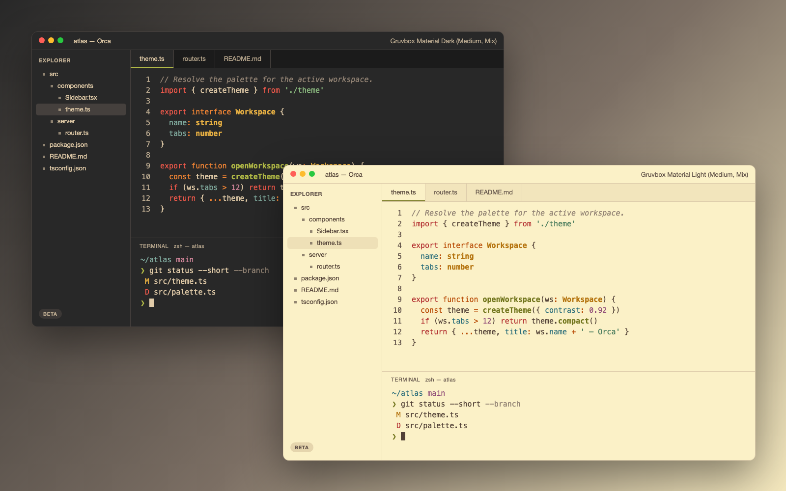

<div align="center">

# Gruvbox Material for Orca

Every [Gruvbox Material](https://github.com/sainnhe/gruvbox-material) variant as Orca app, syntax and terminal themes, for Orca users who want sainnhe's palette everywhere.

[Installation](#-installation) | [Usage](#-usage) | [Features](#-features) | [Development](#-development)

[](https://github.com/fang2hou/orca-gruvbox-material-theme/actions/workflows/check.yml)
[](./LICENSE)

</div>

The plugin ships every upstream combination of background contrast (hard, medium, soft) and foreground palette (Material, Mix, Original), each in dark and light. Colors come from sainnhe's palette definitions, and the few that would fail Orca's contrast check are nudged the smallest amount needed to pass.



## 📦 Installation

Requires Orca 1.4.245 or newer.

```sh
orca plugin install fang2hou/orca-gruvbox-material-theme
```

## 🚀 Usage

Pick an app theme in Orca's Appearance settings, for example **Gruvbox Material Dark (Medium, Mix)** for the dark slot and **Gruvbox Material Light (Medium, Mix)** for the light slot.

The app, the editor and its syntax colors switch to that variant.

Pick the theme with the same name in the terminal settings.

The terminal switches to the matching ANSI colors, background and cursor.

Update to the latest themes:

```sh
orca plugin update fang2hou.gruvbox-material-theme
```

Theme names follow upstream's options: the background sets the contrast, and the foreground sets the accent palette.

## ✨ Features

### `1` App theme

Panels share the `bg0` background, the tab strip sits one step below it, and menus sit one step above. Every public Orca color token comes from the palette, including chat, diff and git colors.

### `2` Syntax colors

Code follows Gruvbox Material's own highlight groups: red keywords, aqua strings, bold green functions, bold yellow types, blue properties and plain variables. Markdown gets orange headings, red list markers and aqua inline code.

### `3` Terminal theme

The terminal uses upstream's terminal mapping, with a dim bright black for shell autosuggestions and a block cursor that keeps the character under it readable.

### `4` Contrast-checked colors

Every theme passes a port of the contrast check Orca runs before painting a theme, so Orca never replaces one of its colors with a fallback. Hover fills stay visible when Orca's Tinted left sidebar is on.

## 🛠️ Development

Requires [mise](https://mise.jdx.dev/) on macOS or Linux. Runtime and tool versions are pinned in `mise.toml`; no environment variables or external services are needed.

```sh
mise install
mise run generate
mise run test
```

`mise run generate` rewrites `themes/`, `terminal/` and the manifest's theme list, and `mise run test` prints `OK` after the unit tests once every check passes. Run `mise run` to list all tasks (for example `report`, `cover`, `validate-plugin`).

<details>
<summary>Preview changes in Orca</summary>

Load the working copy as a development plugin, switch to the changed themes, then unload it:

```sh
orca plugin dev load .
orca plugin dev unload .
```

Workflow, release steps and the palette mapping are in [DEVELOPMENT.md](./DEVELOPMENT.md) and [ARCHITECTURE.md](./ARCHITECTURE.md).

</details>

## 📄 License

[MIT](./LICENSE)

Gruvbox Material colors are by sainnhe (MIT), and the Orca token and scope mapping started from [piter75/orca-gruvbox-material-theme](https://github.com/piter75/orca-gruvbox-material-theme) (MIT). Both notices are in [LICENSE](./LICENSE).
